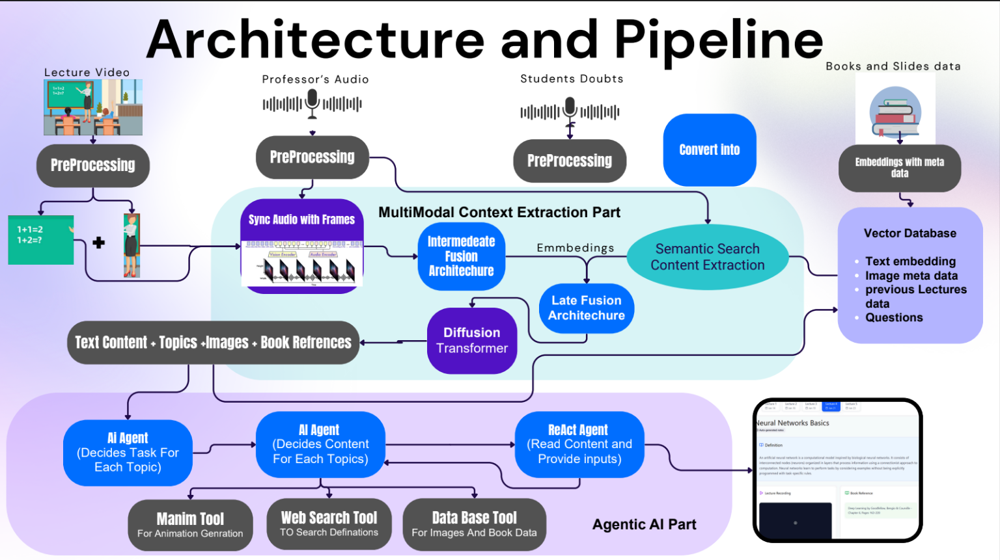

# Smart Scribes

<p align="center">
  
  
  
  
  
  
  
</p>

<p align="center">
  <b>AI-powered classroom intelligence</b> — turns recorded lectures into interactive notes with textbook references, an AI tutor, auto-generated quizzes, and Manim animations.
</p>

<p align="center">
  <a href="https://youtu.be/DzG_FQJkbAA?si=_FozVdJELSWYFovM">
    
  </a>
  <br/>
  <sub>▶️ Click to watch the demo</sub>
</p>

<div align="center">

[Demo video ▶️](https://youtu.be/DzG_FQJkbAA?si=_FozVdJELSWYFovM) ·
[Slides 📋](https://drive.google.com/file/d/1qCfUEhvyrWYzWpPNcaRTe1H38lkaIORh/view?usp=sharing) ·
[Install guide 🛠️](https://docs.google.com/document/d/12SVAEacqcgggpBd9ZEuPtTzkk854s6yFGcVeqSDfwHc/edit?usp=drive_link)

</div>


## 🧭 Contents

- [Features](#-features)
- [How it works](#️-how-it-works)
- [Tech stack](#-tech-stack)
- [Repository layout](#-repository-layout)
- [Getting started](#-getting-started)
- [Configuration](#️-configuration)
- [Testing & CI](#-testing--ci)
- [API routes](#-api-routes)
- [Security notes](#-security-notes)
- [Roadmap](#-roadmap)

## ✨ Features

**For students**

- **Interactive lecture notes** — topic-by-topic explanations, "think about it" questions, matched textbook pages and figures, and the lecture recording.
- **AI tutor chat** — grounded in the open lecture, remembers the conversation, streams answers live, and renders Markdown and LaTeX maths. Falls back to Google web search when the notes don't cover a question (optional).
- **Quiz generator** — MCQ, subjective, or mathematical questions; suggests topics from the current lecture and bases questions on what was actually taught.
- **Manim animations** — short AI-generated visual explanations of key concepts.
- **Personal notes & bookmarks** — saved per lecture in the browser.
- **Doubts** — ask questions that the professor can answer.

**For professors**

- **One-step lecture upload** — audio + video go straight to Google Cloud Storage (resumable, with a progress bar) and are queued for processing.
- **Live processing status** — current stage, progress, error details, and a one-click **Retry** for failed jobs.
- **Slides management** — upload a PDF per lecture; it is also used as the reference book for that lecture's textbook matching.
- **Doubts inbox** — filter by course and status, reply inline.

## 🏗️ How it works



1. **Upload** — the professor dashboard requests a resumable upload URL (`/api/upload/init`) and sends the files directly to GCS under `courses/<course>/lectures/<n>/`.
2. **Queue** — `/api/jobs/create` adds a `pending` row to the `lectures_processing` table in Supabase.
3. **Process** — the Python worker (`Python_Codes/worker.py`) claims the job and runs the pipeline:
   - **Audio**: noise reduction → Whisper transcription in 10-second segments
   - **Video**: frames via ffmpeg → EasyOCR + TrOCR (handwriting) + BLIP captions
   - **Embeddings**: transcript and on-screen text embedded with `all-MiniLM-L6-v2`
   - **Textbook matching**: lecture segments matched to chunks of the course PDF (speech and screen text blended)
   - **Writing**: an LLM (Gemini or AWS Bedrock) writes segment summaries, topics, and explanations
   - **Animations**: an LLM writes Manim scenes, which are rendered to MP4
4. **Publish** — results are uploaded to GCS and the lecture content is upserted into Supabase. The job's stage and progress are reported throughout.
5. **Learn** — the student dashboard loads the lecture. Media is served through `/api/media`, which redirects to short-lived signed URLs, so the bucket can stay private.

## 🧪 Tech stack

| Layer | Technologies |
| --- | --- |
| Web app | Next.js 14 (App Router), React 18, TypeScript, Tailwind CSS, shadcn/ui + Radix, Framer Motion |
| AI in the web app | LangChain with Gemini (Vertex AI or API key) or AWS Bedrock; react-markdown + KaTeX |
| Database | Supabase (Postgres, row-level security) |
| Storage | Google Cloud Storage (resumable uploads, V4 signed URLs) |
| Pipeline | Python 3.10, PyTorch (CUDA), Whisper, EasyOCR, TrOCR, BLIP, sentence-transformers, PyMuPDF, scikit-learn |
| Animation | Manim Community Edition, ffmpeg |
| Tooling | Vitest, pytest, GitHub Actions, Docker Compose |

## 📁 Repository layout

```
Smart-Scribes/
├── Web-Application/              # Next.js app
│   ├── app/api/                  # Route handlers (chat, qna, upload, jobs, media)
│   ├── src/components/           # Student & professor dashboards, UI kit
│   ├── src/lib/                  # Supabase/GCS/LLM helpers (+ __tests__/)
│   ├── middleware.ts
│   └── *.sql                     # Supabase schema, security policies, migrations
├── Python_Codes/                 # Processing pipeline
│   ├── worker.py                 # Polls Supabase for pending jobs
│   ├── pipeline.py               # End-to-end lecture processing
│   ├── audio_embeddings.py       # Whisper ASR + embeddings
│   ├── frames_embeddings.py      # OCR, handwriting, captions
│   ├── MultiModal/               # Book embedding, lecture↔book matching, summaries
│   ├── create_json.py, lastjson.py   # Topic structuring + merge
│   ├── manim2.py                 # Animation generation & rendering
│   ├── google_storage_code.py    # GCS download/upload
│   ├── UploadTOFrontend.py       # Publish lecture content to Supabase
│   ├── llm_provider.py, config.py
│   └── tests/
├── docker/worker.Dockerfile      # Worker container image
├── docker-compose.yml
├── .github/workflows/ci.yml
├── Model Training NoteBooks/
└── requirements.txt              # Pipeline runtime dependencies
```

## 🚀 Getting started

### Prerequisites

- **Node.js 22+** (required by `@supabase/supabase-js`) and npm
- **Python 3.10** and **ffmpeg**; an NVIDIA GPU with ≥ 6 GB VRAM is strongly recommended for the pipeline
- A **Supabase** project
- A **Google Cloud** project with a Storage bucket and a service account key (see [`Web-Application/GCS_SETUP.md`](Web-Application/GCS_SETUP.md))
- An LLM: a **Gemini** API key, Vertex AI via the service account, or **AWS Bedrock**

```bash
git clone https://github.com/Kartavya728/Smart-Scribes.git
cd Smart-Scribes
```

### 1. Database (Supabase)

In the Supabase SQL Editor, run these files from `Web-Application/` in order:

1. `supabase_schema.sql` — tables + sample data
2. `slides_table.sql`
3. `supabase_security.sql` — profiles + row-level security
4. `supabase_phase2.sql` — processing jobs for the worker
5. `supabase_migration_fix_processing.sql` — safe to re-run; upgrades an older `lectures_processing` table

### 2. Web application

```bash
cd Web-Application
cp .env.example .env.local      # fill in Supabase, GCS and LLM settings
npm install
npm run dev                     # http://localhost:3000
```

### 3. Processing worker

**With Docker** (recommended — isolates the AI-generated rendering code):

```bash
cp Python_Codes/.env.example Python_Codes/.env   # fill in values
cp /path/to/service-account.json Python_Codes/gcp-key.json
docker compose up --build worker
```

For GPU acceleration, install the NVIDIA Container Toolkit and uncomment the `deploy` block in `docker-compose.yml`.

**Without Docker:**

```bash
python -m venv venv
source venv/bin/activate        # Windows: venv\Scripts\Activate.ps1
pip install -r requirements.txt
cp Python_Codes/.env.example Python_Codes/.env   # fill in values
cd Python_Codes
python worker.py
```

## ⚙️ Configuration

Full templates live in [`Web-Application/.env.example`](Web-Application/.env.example) and [`Python_Codes/.env.example`](Python_Codes/.env.example). The most important settings:

| Variable | Where | Purpose |
| --- | --- | --- |
| `NEXT_PUBLIC_SUPABASE_URL`, `NEXT_PUBLIC_SUPABASE_ANON_KEY` | web | Supabase client |
| `SUPABASE_URL`, `SUPABASE_SERVICE_ROLE_KEY` | worker | Server-side job updates (never expose to the browser) |
| `GCS_BUCKET_NAME`, `NEXT_PUBLIC_GCS_BUCKET_NAME`, `GCP_PROJECT_ID` | both | Storage bucket |
| `GOOGLE_APPLICATION_CREDENTIALS` (or `_JSON`) | both | Service account key |
| `DEFAULT_LLM_PROVIDER` | both | `gemini` or `aws` |
| `GEMINI_API_KEY` / `AWS_BEARER_TOKEN_BEDROCK` | both | LLM credentials |
| `GOOGLE_SEARCH_API_KEY`, `GOOGLE_SEARCH_ENGINE_ID` | web | Optional web search for chat and quizzes |
| `BOOK_MATCH_AUDIO_WEIGHT` | worker | Share of speech vs. screen text in textbook matching (default `0.7`) |
| `PIPELINE_LOCAL_CORE_ONLY`, `PIPELINE_DISABLE_LLM`, `PIPELINE_LOCAL_*` | worker | Local smoke runs without cloud or LLM calls |

## ✅ Testing & CI

```bash
# Web app
cd Web-Application
npm run typecheck
npm test

# Pipeline (lightweight deps — no GPU or model weights needed)
cd Python_Codes
pip install -r requirements-dev.txt
pytest
```

GitHub Actions ([`.github/workflows/ci.yml`](.github/workflows/ci.yml)) runs the type-check, both test suites, and a production build on every push and pull request.

## 🔌 API routes

| Route | Method | Purpose |
| --- | --- | --- |
| `/api/upload/init` | POST | Create a resumable GCS upload URL for lecture audio/video |
| `/api/upload` | POST | Server-proxied multipart upload (for scripts) |
| `/api/upload/slides` | POST | Upload a slides PDF and record it against its lecture |
| `/api/jobs/create` | POST | Queue a lecture for the worker |
| `/api/media` | GET | Redirect to a short-lived signed URL for lecture media |
| `/api/chat` | POST | AI tutor; streams a plain-text answer |
| `/api/qna/topics` | POST | Suggest quiz topics from lecture content |
| `/api/qna/generate` | POST | Generate quiz questions for a topic |

## 🔒 Security notes

- **Never commit real `.env` / `.env.local` files** or service-account keys; only the `.env.example` templates belong in git.
- **Login is currently a demo stub** (`demo@gmail.com`) — it does not create a Supabase session. The Supabase security policies and `middleware.ts` expect real Supabase Auth, so professor uploads require it before production use.
- The worker **executes LLM-generated Manim code**. It is filtered and runs without access to API keys, but treat it as untrusted: run the worker in the provided container.

## 🔮 Roadmap

- [x] Next.js web application with student & professor dashboards
- [x] Multimodal pipeline (ASR, OCR, captions, textbook matching) integrated with the web app
- [x] Background job queue with live progress and retry
- [x] Streaming AI tutor with Markdown and maths
- [x] Lecture-grounded quiz generation
- [x] Signed media URLs, containerized worker, automated tests & CI
- [ ] Real Supabase Auth with student/professor roles
- [ ] Rate limiting for the AI endpoints
- [ ] Clickable timestamps linking notes to the recording
- [ ] Analytics & export

## 📚 Documentation

- **🎥 Demo video:** [Watch on YouTube](https://youtu.be/DzG_FQJkbAA?si=_FozVdJELSWYFovM)
- **📊 Presentation:** [View slides](https://drive.google.com/file/d/1ddnYoN5SRydPX6gg-2T6K_LbyNhOXlyg/view?usp=drive_link)
- **🧰 Installation guide:** [Open Google Doc](https://docs.google.com/document/d/12SVAEacqcgggpBd9ZEuPtTzkk854s6yFGcVeqSDfwHc/edit?usp=drive_link)
- **In this repo:** [Quick start](Web-Application/QUICK_START.md) · [GCS setup](Web-Application/GCS_SETUP.md) · [Supabase setup](Web-Application/README_SUPABASE_SETUP.md)
- **External:** [Google Cloud APIs](https://docs.cloud.google.com/apis/docs/overview) · [Supabase API](https://supabase.com/docs/guides/api)

## 🤝 Contributing

1. Fork the repository
2. Create a feature branch: `git checkout -b feat/your-feature`
3. Make sure `npm run typecheck`, `npm test` and `pytest` pass
4. Commit (`git commit -m "feat: add your feature"`), push, and open a pull request

## 📝 License & acknowledgments

Built for the **IIT Mandi iHub Hackathon**. No open-source license has been chosen yet, so all rights are reserved by the authors.

Thanks to Next.js, Tailwind CSS, Radix UI, shadcn/ui, Supabase, Hugging Face, Manim Community, and LangChain.

<p align="center">
  
  <br/>
  <i>Built with ❤️ for the future of education</i>
</p>
