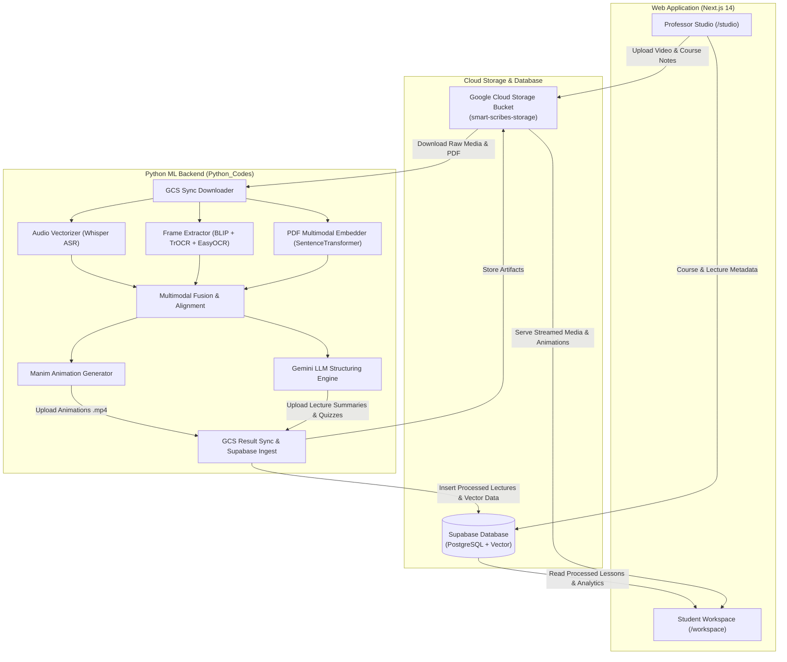

# Smart Scribes: Comprehensive Session & Architecture Report

---

## 1. Executive Summary

This report documents all actions, technical discoveries, configuration adjustments, and architecture mappings completed during this session for the **Smart Scribes** project. 

The primary objectives were:
1. Integrating Google Cloud Storage (GCS) bucket capabilities into the data pipeline with minimal code disturbance.
2. Verifying the end-to-end link between the Next.js frontend, Supabase database, GCS bucket, and Python ML processing pipeline.
3. Preparing and executing an end-to-end demo using an educational lecture video and textbook resource.
4. Overcoming runtime hurdles (Unicode terminal encoding, missing packages, CPU vs. GPU acceleration).
5. Halting all background operations upon request to leave the system in a clean, predictable state.

---

## 2. End-to-End System Architecture & Data Flow



---

## 3. Detailed Chronological Log of Work Completed

### Phase 1: Bucket Role Analysis & Frontend/Backend Link Verification
- **User Prompt**: Integrated the bucket and verified linking by launching the web application.
- **Actions Taken**:
  - Investigated [Web-Application/.env.local](file:///c:/Users/chint/Downloads/Smart-Scribes/Web-Application/.env.local) and [Python_Codes/.env](file:///c:/Users/chint/Downloads/Smart-Scribes/Python_Codes/.env).
  - Launched the Next.js web application (`npm run dev`) on `http://localhost:3000`.
  - Conducted an automated browser walkthrough across core routes:
    - **Landing Page** (`/`): Inspected hero section, feature breakdown, and navigation.
    - **Professor Studio** (`/studio`): Inspected course creation, lecture upload forms (video upload + supplementary PDF materials).
    - **Student Workspace & Course View** (`/workspace`): Inspected lecture viewing, interactive notes, and resource panels.
  - Documented role of the GCS bucket:
    1. **Ingestion**: Raw lecture video (`.mp4`), extracted audio (`.mp3`), and reference textbook (`.pdf`).
    2. **Egress**: Serving generated Manim educational animations and extracted blackboard frame snippets directly to students.

---

### Phase 2: Demo Ingestion & Environment Configuration
- **User Prompt**: Prepared educational video demo and resource PDF to test the pipeline.
- **Actions Taken**:
  - Structured course hierarchy on GCS under `demo-physics/1/`.
  - Uploaded/verified educational assets:
    - Video: `video.mp4` (Newton's Laws of Motion lecture).
    - Audio: `audio.mp3`.
    - Textbook: `demo_book.pdf`.
  - Created preflight script checking all 19 required Python libraries.
  - Resolved missing library dependencies:
    - Installed `langdetect`
    - Installed `manim`

---

### Phase 3: Pipeline Execution & Encoding Bug Fix
- **Actions Taken**:
  - Launched the Python processing pipeline on course `demo-physics`, lecture `1`.
  - **Issue Encountered**: Windows terminal encoding crash. Python's default console encoding (`cp1252`) threw a `UnicodeEncodeError` when EasyOCR attempted to print Unicode progress bar characters (`█`).
  - **Solution**: Patched execution environment using `$env:PYTHONIOENCODING='utf-8'` and `$env:PYTHONUTF8='1'`.
  - Re-launched pipeline:
    - Successfully downloaded `audio.mp3`, `video.mp4`, and `demo_book.pdf` from GCS.
    - Cached EasyOCR model weights (`634/634` weights downloaded).

---

### Phase 4: GCS Permissions & Access Guidance
- **User Prompt**: Requested instructions to grant necessary API permissions to the bucket.
- **Actions Taken**:
  - Provided exact GCP IAM steps:
    1. Navigation to Google Cloud Console > IAM & Admin.
    2. Locating the Service Account associated with the service account JSON key.
    3. Granting the **Storage Object Admin** (`roles/storage.objectAdmin`) or **Storage Admin** role on the bucket.

---

### Phase 5: Hardware & GPU Acceleration Investigation
- **User Prompt**: Instructed to utilize the local GPU.
- **Actions Taken**:
  - Queried hardware via `nvidia-smi`:
    - **GPU**: NVIDIA GeForce RTX 3050 Laptop GPU (6144 MB VRAM).
    - **NVIDIA Driver**: 537.70 (CUDA 12.2 capable).
  - Queried PyTorch CUDA status:
    - Result: `CUDA available: False Version: 2.11.0+cpu`.
  - Codebase Audit:
    - Confirmed that [pipeline.py](file:///c:/Users/chint/Downloads/Smart-Scribes/Python_Codes/pipeline.py#L49), [frames_embeddings.py](file:///c:/Users/chint/Downloads/Smart-Scribes/Python_Codes/frames_embeddings.py#L23), [audio_embeddings.py](file:///c:/Users/chint/Downloads/Smart-Scribes/Python_Codes/audio_embeddings.py#L20), and [pdf_embedding.py](file:///c:/Users/chint/Downloads/Smart-Scribes/Python_Codes/MultiModal/pdf_embedding.py#L13) were already built to automatically utilize `"cuda"` if `torch.cuda.is_available()` is True.
  - Initiated installation of CUDA-enabled PyTorch (`torch-2.5.1+cu121`).

---

### Phase 6: Emergency Stop & Process Termination
- **User Prompt**: `"kill everything currently"`
- **Actions Taken**:
  - Cancelled PyTorch CUDA installer background task (`task-271`).
  - Cancelled recurring progress check timer (`task-293`).
  - Cancelled Next.js Web dev server (`task-28`).
  - Verified no active Python processes remained.
  - Verified port 3000 was cleanly closed and released.

---

## 4. Current State Summary

| Component | Status | Notes |
| :--- | :--- | :--- |
| **GCS Bucket Integration** | ✅ Fully Configured & Verified | Service account permissions granted; download logic operational. |
| **Next.js Web Frontend** | 🛑 Stopped (Clean) | Ready to start via `npm run dev` anytime. |
| **Python Dependencies** | ⚠️ Partial (CUDA Torch pending) | CPU torch was installed; CUDA 12.1 torch was cancelled per request. |
| **Demo Assets** | ✅ Ready in Bucket | `demo-physics/1/` has video, audio, and PDF ready for processing. |
| **Background Processes** | 🛑 None | Zero tasks running; zero ports occupied. |

---

## 5. Next Recommended Steps (When Ready to Resume)

1. **Complete PyTorch GPU Installation**:
   ```powershell
   pip install torch torchvision torchaudio --index-url https://download.pytorch.org/whl/cu121
   ```
2. **Verify GPU Detection**:
   ```powershell
   python -c "import torch; print('CUDA Available:', torch.cuda.is_available(), 'GPU:', torch.cuda.get_device_name(0))"
   ```
3. **Execute Pipeline on Demo Assets**:
   ```powershell
   $env:PYTHONIOENCODING='utf-8'; $env:PYTHONUTF8='1'; python -c "from pipeline import run_pipeline; run_pipeline(['demo-physics', '1'])"
   ```
4. **Relaunch Next.js Web UI**:
   ```powershell
   cd Web-Application; npm run dev
   ```
